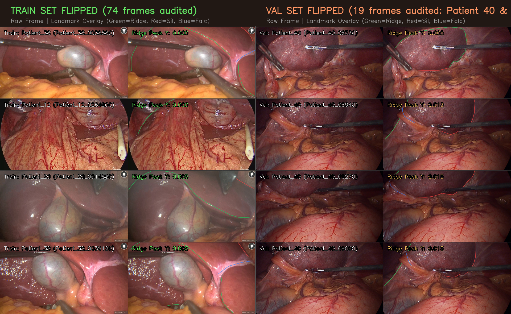
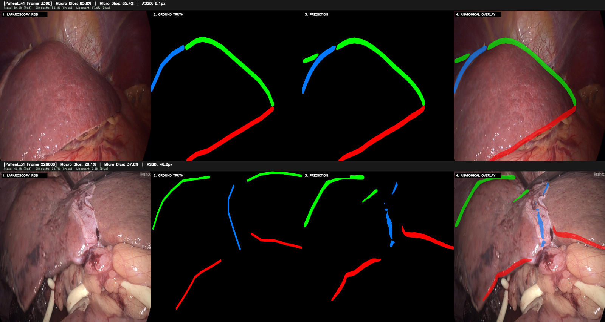

# 🏥 Surgical AI: Diagnosing Geometric Disparity and Temporal Modeling in Laparoscopic Liver Landmark Segmentation

[](https://www.python.org/)
[](https://pytorch.org/)
[](LICENSE)
[](docs/DATASET_ANALYSIS.md)
[](#benchmark-results)

> **Official repository for the research paper:**  
> *"Diagnosing Geometric Disparity and Temporal Modeling in Laparoscopic Liver Landmark Segmentation"*  
> Technical Paper & Preprints: [`paper/report.tex`](paper/report.tex) • [`paper/report.pdf`](paper/report.pdf)

---

## 📌 Executive Summary

Laparoscopic liver anatomical landmark segmentation is an essential prerequisite for non-rigid 2D–3D registration during augmented reality (AR) hepatectomy. Accurate intraoperative delineation of continuous curvilinear landmarks—namely the **anterior liver ridge**, **silhouette contour**, and **falciform ligament**—enables anatomical guidance under severe tissue deformation and surgical occlusion.

This research repository conducts a systematic investigation of state-of-the-art architectures on the **L3D** benchmark, leading to three central findings:
1. **Discovery of Benchmark Geometric Disparity:** We discover that benchmark validation splits contain nearly double the proportion of extreme surgical traction states compared to training sets (15.6% vs. 8.0%), causing static query models to suffer catastrophic spatial prior inertia (collapsing to 7.56% Dice on Patient 40).
2. **Topological Anchor Steering:** We formulate a deterministic 4-junction biomechanical steering mechanism that anchors query attention to physiological confluence points, reducing surface distance error from 28.43 px to 22.64 px.
3. **Stratified Temporal Prototype Modeling:** By unifying pose-stratified training distributions with multi-frame causal prototype cross-attention, our **Stratified Temporal Transformer** establishes new state-of-the-art records on the frozen official L3D test benchmark: **74.31% Micro Dice**, **71.92% Macro Dice**, and **15.37 px ASSD** (cutting boundary error by more than 50% over published baselines).

---

## 🔬 Qualitative Highlights

### Surgical Pose Inversion & Mechanical Traction Disparity

*Figure 1: Comparison of mechanical traction states between training and validation cohorts. Grasper elevation hoists the anterior liver ridge (Green) into the upper canvas, yet validation splits possess a 1.95× higher concentration of these non-rigid poses (15.6% vs. 8.0%).*

### Test Benchmark Boundary Tracking

*Figure 2: Qualitative landmark predictions on official test cases. Top: Patient 41 achieves 85% Macro Dice (11.60 px mean ASSD across the cohort). Bottom: Patient 31 under extreme vertical traction demonstrates the remaining frontier of non-rigid tissue deformation modeling.*

---

## 🏆 Benchmark Results

### Official L3D Frozen Test Benchmark (109 Frames, 4 Patients)

Evaluated under strict clinical mutual exclusivity on the native $1024 \times 1024$ canvas:

| Method / Architecture | Micro Dice (%) $\uparrow$ | Macro Dice (%) $\uparrow$ | ASSD (px) $\downarrow$ | Anterior Ridge (%) | Silhouette (%) | Falciform Ligament (%) |
|:---|:---:|:---:|:---:|:---:|:---:|:---:|
| **TopoNet** (MICCAI 2025) | 65.19 | 59.79 | 28.07 | 64.30 | 72.10 | 42.97 |
| **BCRNet** (MICCAI 2025) | --- | 69.57 | 43.55 | 68.12 | 74.30 | 66.29 |
| **A2ONet** (MICCAI 2026) | --- | 65.31 | 49.89 | 63.80 | 71.20 | 60.93 |
| **Mask2Former Baseline** | --- | 65.73 | 28.43 | 66.81 | 71.45 | 58.93 |
| **Junction-Steered M2F** | --- | 66.86 | 22.64 | 67.55 | 73.12 | 59.91 |
| **Temporal M2F (T=3)** | 68.18 | 65.36 | 26.86 | 66.22 | 70.04 | 59.83 |
| **Stratified Temporal M2F (Ours)** | **74.31** | **71.92** | **15.37** | **72.53** | **76.66** | **66.58** |

### Per-Patient Breakdown on Official Test Benchmark

| Test Patient | Frames | Operative Condition | Macro Dice (%) | ASSD (px) $\downarrow$ |
|:---|:---:|:---|:---:|:---:|
| **Patient 41** | 84 | Canonical diaphragmatic view with grasper | **76.70%** | **11.60 px** |
| **Patient 21** | 7 | Canonical orientation, clear visibility | **73.68%** | **23.57 px** |
| **Patient 51** | 4 | Constrained field of view | **62.88%** | **18.79 px** |
| **Patient 31** | 14 | Severe mechanical elevation / traction | **44.97%** | **32.89 px** |

---

## 📁 Repository Structure

```text
surgical-ai/
├── README.md                          # Master documentation & benchmark leaderboards
├── LICENSE                            # MIT License
├── requirements.txt                   # Production Python dependencies
│
├── config/                            # Experiment configurations & split contracts
│   ├── 5fold_patient_splits.json      # Locked SHA-256 patient-disjoint 5-fold splits
│   ├── 5fold_cross_validation.md      # Protocol & zero-leakage guarantees
│   └── code_conventions.md            # Coding standards & determinism
│
├── paper/                             # Research paper source & assets
│   ├── report.tex                     # NeurIPS 2025 preprint LaTeX source
│   ├── report.pdf                     # Compiled preprint manuscript
│   ├── neurips_2025.sty               # Style file
│   ├── figures/                       # High-resolution figures (fig1 through fig6)
│   └── proposal/                      # Long-term research grant proposal
│
├── experiments/
│   ├── README.md                      # Detailed experimental progression narrative
│   │
│   ├── static/                        # 16 Systematic single-frame experiments
│   │   ├── EXPERIMENT_1/              # TopoNet replication & systematic ablations
│   │   ├── EXPERIMENT_2/              # Mask2Former Swin-Tiny baseline & query ablations
│   │   ├── EXPERIMENT_3/              # Patch Bézier representation
│   │   ├── EXPERIMENT_4/              # Landmark Bézier representation
│   │   ├── EXPERIMENT_5/              # Patient 40 diagnostic failure audit
│   │   ├── ...                        # EXP 6–13: Query routing, spatial heatmaps, loss probes
│   │   ├── EXPERIMENT_14/             # Pose-Stratified Junction-Steered M2F
│   │   ├── EXPERIMENT_15_.../         # Temporal Prototype Transformer (T=3 causal keyframes)
│   │   └── EXPERIMENT_16_.../         # Pose-Stratified Temporal Transformer (SOTA)
│   │
│   ├── temporal/                      # Universal Video Landmark Benchmark (MinVIS)
│   │   ├── train.py                   # 5-fold cross-validation training entrypoint
│   │   ├── evaluate.py                # Validation and frozen test evaluation CLI
│   │   ├── aggregate.py               # Automated master leaderboard generator
│   │   ├── core/                      # Datasets, training engine, evaluation metrics
│   │   ├── models/                    # MinVIS video model + Hungarian tracker
│   │   ├── configs/                   # Experiment YAML configurations
│   │   └── notebooks/                 # Lightweight Kaggle Git Runner notebook
│   │
│   └── archive/                       # Archived early prototypes (EXP_01 to EXP_13)
│
├── shared/                            # Reusable shared utilities
│   ├── utils/                         # Metrics, split loaders, visualization overlays
│   └── math_lab/                      # Synthetic mathematical probes (order, curvature, losses)
│
└── docs/                              # Supplementary research documentation
    ├── EXPERIMENT_PROTOCOL.md         # Scientific standards & pre-flight specifications
    ├── DATASET_ANALYSIS.md            # Geometric disparity & surgical traction discovery
    └── CHANGELOG.md                   # Research milestones & timeline
```

---

## 🚀 Quickstart & Reproduction

### 1. Environment Setup

```bash
# Clone the repository
git clone https://github.com/KhoaTryToCode/surgical_ai.git
cd surgical_ai

# Create and activate virtual environment
python3 -m venv .venv
source .venv/bin/activate

# Install dependencies
pip install -r requirements.txt
```

### 2. Dataset Setup

Place the L3D dataset in `data/L3D` or mount it on Kaggle (`/kaggle/input/laparoscopic-liver-landmarks/L3D`):
```text
data/L3D/
├── train/          # 921 training frames & landmark JSONs
├── val/            # 122 validation frames
└── test/           # 109 frozen official test frames
```

### 3. Running Video Benchmark on Kaggle / Dual GPUs

We provide a lightweight **Git Runner Notebook** (`experiments/temporal/notebooks/Kaggle_Temporal_Runner.ipynb`) designed to run on Kaggle GPU instances:
* Clones the repository dynamically to prevent implementation drift.
* Auto-detects Kaggle dataset paths.
* Runs 5-fold cross-validation, validation evaluation, test evaluation, and leaderboard collation in a single automated cell:

```bash
# Inside experiments/temporal/
python train.py --model minvis --fold_idx 0 --epochs 40 --batch-size 4 --device cuda
python evaluate.py --model minvis --checkpoint checkpoints/minvis/best_minvis_fold0.pth --split test
python aggregate.py
```

---

## 📖 Key Research Documents

* 📑 **Full Paper Preprint:** [`paper/report.pdf`](paper/report.pdf)
* 🔬 **Dataset Geometric Disparity Analysis:** [`docs/DATASET_ANALYSIS.md`](docs/DATASET_ANALYSIS.md)
* 📋 **Experimentation Protocol & Pre-Flight Standards:** [`docs/EXPERIMENT_PROTOCOL.md`](docs/EXPERIMENT_PROTOCOL.md)
* 📈 **16-Experiment Progression Narrative:** [`experiments/README.md`](experiments/README.md)
* 📜 **Project Timeline & Milestones:** [`docs/CHANGELOG.md`](docs/CHANGELOG.md)

---

## 📝 Citation

If you find this research, dataset insights, or code useful in your academic work, please cite:

```bibtex
@article{surgical_ai_2026,
  title   = {Diagnosing Geometric Disparity and Temporal Modeling in Laparoscopic Liver Landmark Segmentation},
  author  = {Surgical AI Research Group},
  journal = {arXiv preprint},
  year    = {2026}
}
```

---

## 📄 License

This project is licensed under the MIT License — see the [LICENSE](LICENSE) file for details.
